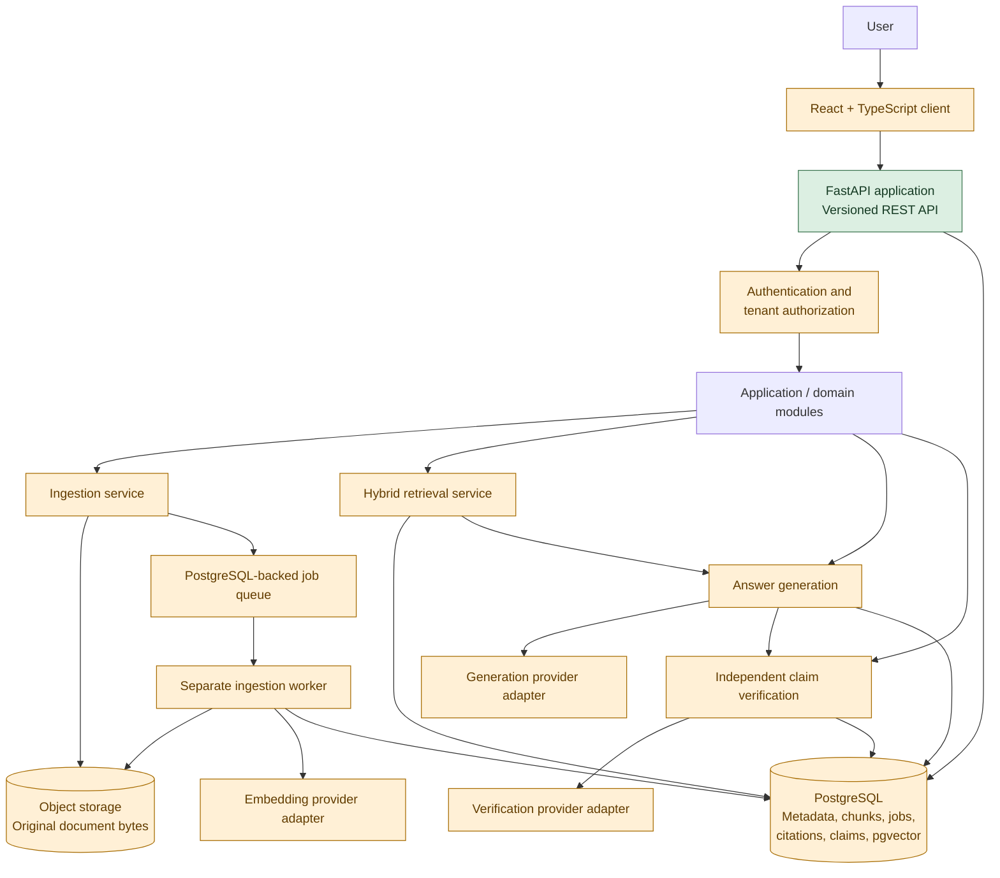
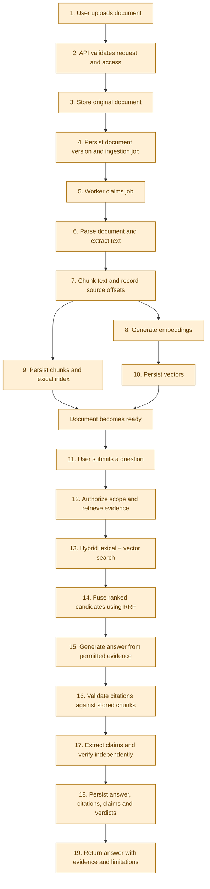

# EvidenceOS MVP Architecture

**Status:** Decided for MVP; implementation and deployment validation pending  
**Issue:** [DES-01: Finalize MVP architecture and ADRs](https://github.com/Ishaan6233/EvidenceOS/issues/1)

## 1. Objective and scope

EvidenceOS ingests source documents, retrieves relevant passages, generates cited answers, and independently checks answer claims against available evidence. The MVP prioritizes correctness, traceability, reproducibility, security, and a complete workflow over service count or latency promises.

This is the authoritative MVP architecture. It records decisions; it does not claim those components are implemented. Knowledge graph construction, microservices, Kubernetes, complex orchestration, and open-web evidence acquisition are deferred.

## 2. Decisions

| Decision | MVP choice | Status |
|---|---|---|
| Backend | Python + FastAPI as the sole application backend | **Decided** |
| Application shape | Modular monolith; one deployable API, separate worker process | **Decided** |
| Structured state | PostgreSQL | **Decided** |
| Vector and lexical retrieval | pgvector plus PostgreSQL full-text search, fused with RRF | **Decided** as baseline; performance validation pending |
| Original files | Storage interface; local filesystem in development, S3-compatible object storage in deployment | **Decided** |
| Background work | Separate worker, PostgreSQL-backed jobs table, safe claims, retries, idempotency | **Decided** |
| Model boundary | Provider-neutral embedding, generation, and verification interfaces; explicit egress policy | **Decided** |
| API | FastAPI routes under `/api/v1` | **Decided** |
| Dedicated vector service | Qdrant only if deployment constraints or benchmarked requirements justify it | **Deferred pending evidence** |

Business rules live in modules/services; route handlers validate, authorize, and orchestrate rather than owning domain logic.

### 2.1 Implementation status

Status reflects the repository's current implementation, not the desired architecture.

| Capability | Status | Evidence / next step |
|---|---|---|
| FastAPI application startup | Implemented | `backend/app/main.py` |
| Environment-based settings | Implemented at scaffold level | `backend/app/core/config.py` |
| Basic health endpoints | Implemented at scaffold level | Backend health routes and tests |
| Automated scaffold tests | Present; must pass in the validation environment | `backend/tests/` |
| React + TypeScript frontend | Planned / not present in the current repository snapshot | Create frontend project |
| Authentication and tenant isolation | Planned | Implement and test authorization |
| Document upload and versioning | Planned | Define API contract and persistence |
| Original-file storage adapter | Planned | Implement local adapter and deployment adapter |
| PostgreSQL schema and migrations | Planned | Add persistence models and migrations |
| PDF, DOCX, and TXT ingestion | Planned | Implement parsing and ingestion worker |
| Durable background jobs and retries | Planned | Implement PostgreSQL-backed job lifecycle |
| Hybrid lexical/vector retrieval with RRF | Planned | Implement and evaluate retrieval |
| Embedding and answer-generation adapters | Planned | Implement provider interfaces and policy |
| Citation validation and provenance | Planned | Persist and validate source references |
| Independent claim verification | Planned | Implement verification and evidence links |
| Production observability and deployment | Planned | Add operational configuration and deployment validation |

The existence of an architectural package directory, interface proposal, configuration setting, or diagram does not mean its corresponding product capability is implemented. Update this table only when code and appropriate tests demonstrate the capability.

### 2.1 Implementation status

Status reflects the repository's current implementation, not the desired architecture.

| Capability | Status | Evidence / next step |
|---|---|---|
| FastAPI application startup | Implemented | `backend/app/main.py` |
| Environment-based settings | Implemented at scaffold level | `backend/app/core/config.py` |
| Basic health endpoints | Implemented at scaffold level | Backend health routes and tests |
| Automated scaffold tests | Present; must pass in the validation environment | `backend/tests/` |
| React + TypeScript frontend | Planned / not present in the current repository snapshot | Create frontend project |
| Authentication and tenant isolation | Planned | Implement and test authorization |
| Document upload and versioning | Planned | Define API contract and persistence |
| Original-file storage adapter | Planned | Implement local adapter and deployment adapter |
| PostgreSQL schema and migrations | Planned | Add persistence models and migrations |
| PDF, DOCX, and TXT ingestion | Planned | Implement parsing and ingestion worker |
| Durable background jobs and retries | Planned | Implement PostgreSQL-backed job lifecycle |
| Hybrid lexical/vector retrieval with RRF | Planned | Implement and evaluate retrieval |
| Embedding and answer-generation adapters | Planned | Implement provider interfaces and policy |
| Citation validation and provenance | Planned | Persist and validate source references |
| Independent claim verification | Planned | Implement verification and evidence links |
| Production observability and deployment | Planned | Add operational configuration and deployment validation |

The existence of an architectural package directory, interface proposal, configuration setting, or diagram does not mean its corresponding product capability is implemented. Update this table only when code and appropriate tests demonstrate the capability.

### ADR-001 — FastAPI as the sole application backend

**Decision — Decided:** Use Python and FastAPI as the only MVP application backend. All product routes are versioned under `/api/v1`; domain/application services remain independent of route handlers and provider SDKs.

**Rationale:** Document parsing, embeddings, retrieval, and model integration fit the Python ecosystem. A single backend avoids duplicated domain logic, deployment, authentication, and operations that would come from running Spring Boot and FastAPI together without a concrete service boundary.

**Trade-off:** Python throughput may require optimization at higher load. Optimize from measurements. A second backend requires a concrete ownership, isolation, or performance case and a new design review.

### ADR-002 — Modular monolith with a separate worker process

**Decision — Decided:** Use one deployable FastAPI backend organized into ingestion, retrieval, generation, verification, storage, security, and jobs modules. Run ingestion/indexing as a separate worker process using the same backend/domain package. Keep HTTP, domain, and adapter code separated.

**Rationale:** The MVP needs clear boundaries but does not yet have a demonstrated need for independently deployed services. Modules allow focused testing and future extraction without introducing distributed-system operations now.

**Trade-off:** Modules share a release lifecycle; the worker can scale separately. Extract a service only when measured scale, security isolation, or independent ownership justifies it.

### ADR-003 — PostgreSQL, pgvector, and object storage

**Decision — Decided baseline:** PostgreSQL stores tenant-scoped metadata, lifecycle, document versions, chunks/provenance, jobs, answers, citations, claims, verification/evidence links, and audit metadata. PostgreSQL full-text search supplies lexical candidates; pgvector supplies initial dense retrieval; Reciprocal Rank Fusion combines the rankings. Original files use a storage interface with local filesystem storage in development and S3-compatible object storage in deployment. Keep vector access behind an interface; consider Qdrant only if pgvector is unavailable in the target deployment or reproducible measurements establish a need.

**Rationale:** This gives the first release transactional metadata and both retrieval modes with fewer services to operate. It provides a clear path to a dedicated vector service if evidence requires one.

**Trade-off:** PostgreSQL/pgvector performance and scale have not been measured for EvidenceOS. Before claiming another backend is better or switching, compare on identical vectors, queries, filters, and protocol, reporting Recall@k against exact neighbors, p50/p95/p99, throughput, memory, persistence/recovery, filter correctness, and update/delete behavior. Local filesystem storage is for development, not a production durability claim. Cross-system object deletion needs retryable reconciliation.

### ADR-004 — PostgreSQL-backed durable ingestion jobs

**Decision — Decided:** Run a separate worker process that polls a PostgreSQL jobs table. Claim jobs atomically with leases/row locking (for example, `FOR UPDATE SKIP LOCKED`), record attempts and sanitized errors, retry with bounded backoff, and make stage effects idempotent using tenant/version/stage keys. A job is complete only after required durable writes and index updates succeed.

**Rationale:** Ingestion outlives HTTP requests and must survive restarts. A persisted jobs table avoids adding a broker before MVP workload justifies operating one.

**Trade-off:** PostgreSQL is not assumed to provide broker-scale throughput. Measure queue age, throughput, lock contention, and recovery. Add a dedicated queue only when those measurements establish the need.

### ADR-005 — Provider-neutral AI interfaces and explicit egress

**Decision — Decided:** Define separate provider-neutral interfaces for embedding, answer generation, and claim verification. Embeddings default to local execution. External generation requires explicit provider/model configuration and an egress policy permitting that context class. Local-only mode makes no external requests and never silently falls back. Verification remains independent from answer generation. Persist configuration identifiers for auditability without logging source text or secrets.

**Rationale:** Providers and execution modes can change without coupling retrieval and business logic to a vendor. Separate verification prevents answer-generation confidence from being mistaken for evidence support.

**Trade-off:** External generation shares permitted context with the configured provider; zero third-party disclosure is not promised when egress is enabled. Local model support is optional and only exists once implemented and evaluated. Policy denial/provider failure are operational states, not factual verdicts.

## 3. Component boundaries

- **React + TypeScript client:** document upload/status, search/question entry, answer display, source inspection, and claim verdicts. It does not decide tenant access.
- **FastAPI application:** `/api/v1` schemas, authentication/authorization integration, tenant scoping, policy enforcement, and application-service orchestration.
- **Domain/application modules:** `ingestion`, `retrieval`, `generation`, `verification`, `storage`, `security`, and `jobs`. Modules expose explicit interfaces and avoid importing HTTP concerns into domain rules.
- **PostgreSQL:** tenants/collections, documents and immutable versions, chunk text/provenance, job state, answers, citations, claims, verification/evidence links, audit metadata, lexical indexes, and pgvector embeddings.
- **Object storage adapter:** local filesystem implementation for development and S3-compatible implementation for deployment. Store opaque tenant-scoped keys, content hashes, and version references in PostgreSQL; do not expose raw object keys as authorization.
- **Worker process:** polls and safely claims persisted jobs, parses documents, creates source-aligned chunks, computes embeddings, updates lexical/vector indexes, and records terminal or retry state.
- **Provider adapters:** embedding, answer generation, and claim verification are separate provider-neutral interfaces. Retrieval does not depend on an LLM vendor.
- **Evaluation and observability:** fixed datasets and reproducible metrics; structured logs, metrics, traces, and sanitized audit events without secrets or unnecessary source text.

### 3.1 Component diagram

The diagram describes the **target MVP architecture**, not a claim that every component is implemented.

**Status legend:** Green means only the basic API scaffold is implemented; amber means planned target architecture. The domain, storage, database, worker, and AI components are architectural responsibilities, not currently working features merely because they appear in the diagram.

### Component responsibilities

| Component | Responsibility | MVP status |
|---|---|---|
| React + TypeScript client | Upload, ask questions, inspect answers and sources | Planned |
| FastAPI | Request validation, API routing, orchestration | Basic scaffold implemented; product endpoints planned |
| Authentication and tenant authorization | Enforce identity and resource access | Planned |
| PostgreSQL + pgvector | Structured records, lexical indexes, vector retrieval | Decided; integration planned |
| Object storage | Preserve original document bytes | Interface and implementation planned |
| Ingestion worker | Parse, chunk, embed, and index documents asynchronously | Planned |
| Retrieval service | Combine lexical and dense rankings using RRF | Planned |
| Generation adapter | Generate answers from permitted evidence | Planned |
| Verification service | Check individual claims against evidence | Planned |
| Provenance records | Link answers and claims to stored source versions and spans | Planned |
| Health endpoint and configuration | Basic service health and environment settings | Implemented in the scaffold |

### 3.2 End-to-end data-flow diagram

This diagram shows the intended workflow after the planned services are implemented.

#### Data and trust boundaries

- Original document bytes are stored separately from searchable metadata and derived representations.
- PostgreSQL is the authoritative store for document versions, chunk provenance, jobs, answers, citations, claims, and verification links.
- Lexical and vector search produce candidate evidence; retrieval relevance does not itself establish factual support.
- Generated citation identifiers are untrusted until resolved against stored chunks and immutable document versions.
- Verification results describe support in the available evidence. A provider error or timeout is an execution failure, not a factual verdict.
- External model calls may receive source context only when the configured provider and data-egress policy permit it.

## 4. End-to-end data flow

### Document ingestion

1. An authenticated client streams a document to FastAPI. The API validates size/type, computes a content hash, enforces tenant/collection authorization, and creates a versioned document record plus queued job.
2. Original bytes are written through the storage interface. If storage or metadata creation fails, the operation returns a sanitized error and cannot mark the document ready; orphan cleanup is retryable.
3. The worker claims a due job transactionally (e.g. row lock with `SKIP LOCKED`), records attempt/lease state, and processes it outside the HTTP lifecycle.
4. Parsers handle MVP PDF, DOCX, and TXT inputs, preserve page locations when available, and emit canonical extracted text. Unsupported, malformed, oversized, or unsafe inputs fail with explicit job status.
5. Deterministic chunking creates stable IDs and offsets into canonical text, tied to an immutable document version and page/source location.
6. Local-default embedding generates vectors. PostgreSQL stores chunk/provenance data, full-text representation, and pgvector embedding. Index updates are idempotent.
7. The job becomes completed only after all required durable writes/index operations succeed. Retry exhaustion records a sanitized failure; a document is never reported ready on partial indexing.

### Question answering and verification

1. Client submits a question and permitted collection scope. API derives tenant identity from authenticated context, validates access, and records relevant configuration versions.
2. Retrieval runs PostgreSQL lexical and pgvector dense search with tenant and metadata filters, then merges ranked candidates with Reciprocal Rank Fusion (RRF).
3. Evidence selection returns chunk IDs plus exact document version and source spans. Relevance is not a support verdict.
4. Generation receives only selected context permitted by the explicit data-sharing policy. Local-only mode has no external call or external fallback.
5. Citation references in model output are treated as untrusted identifiers and validated against retrieved, stored chunks. A valid citation resolves to immutable document version and span, with page information where available.
6. Claim extraction maps atomic factual claims to answer offsets. Independent verification checks each claim against the available evidence and stores evidence links and one of `supported`, `contradicted`, `insufficient_evidence`, or `review_required`.
7. Answer, citations, claims, verdicts, evidence links, and provider/model/prompt/retrieval configuration versions are persisted. Operational errors such as timeouts are represented as execution failures, not epistemic verdicts.
8. API returns answer, validated citations, claim verdicts, and limitations. Insufficient evidence is shown explicitly rather than presented as established fact.

## 5. Provenance and tenant invariants

Core entities: Tenant, Collection, Document, DocumentVersion, Chunk, Job, Answer, Citation, Claim, Verification, EvidenceLink, and AuditEvent.

- Every data access, object operation, job, search query, cache key, and verification operation is tenant scoped using authenticated identity.
- Each chunk belongs to one immutable document version and records canonical offsets and page/source location when available.
- Each citation points to an existing stored chunk and version; an LLM-authored page string alone is not a citation.
- Retrieval result, citation, and verification remain distinct concepts.
- Deletion/re-ingestion invalidates stale jobs, caches, lexical rows, and vector rows; stale evidence is not returned.
- Persist configuration identifiers needed to interpret results, but avoid copying sensitive text into logs/audit metadata.

## 6. Durable job model

The jobs table is the MVP queue. A claim operation must atomically lease one due job to a worker, increment attempts, and prevent concurrent claims. Jobs have explicit states (`queued`, `running`, `retry_wait`, `completed`, `failed`, `cancelled`), lease/heartbeat information, bounded attempts, next retry time, and sanitized error codes. Stage effects use deterministic idempotency keys derived from tenant, document version, and stage. Reconciliation can retry partial index updates or rebuild derived indexes from authoritative document/chunk records.

PostgreSQL-backed polling is simpler to operate for MVP scale but is not treated as a high-throughput broker. Adopt a dedicated queue only when measured throughput/latency or operational recovery demonstrates need, with a new ADR.

## 7. Security and outbound-data policy

Uploaded contents are untrusted data and may include prompt injection. They cannot override system policy or tenant authorization. Strict local-only mode denies external model traffic at the gateway and transport boundary; it never silently falls back. External generation requires an explicitly permitted provider/model and a policy allowing the context class. Provider calls, policy decisions, failures, and audit events are sanitized. Hosted object storage combined with external generation can disclose context to that provider; the system does not claim zero third-party disclosure when egress is enabled.

## 8. Retrieval performance and backend changes

PostgreSQL full-text search + pgvector is the initial hybrid baseline. RRF is applied to independently ranked dense and lexical lists after identical tenant/metadata constraints. Qdrant is a future candidate behind a vector-store interface, not a preselected production replacement.

Before claiming a dedicated backend is better or switching, compare Qdrant and embedded PostgreSQL/pgvector using identical vectors, query set, filters, and evaluation protocol. Report Recall@k against exact-nearest-neighbor ground truth, p50/p95/p99, throughput, memory, persistence/recovery, filter correctness, update/delete behavior, and reproducibility.

The `<50 ms` target for hybrid search above 100,000 chunks is unverified. Define service search latency from request receipt at retrieval service through fused ranked-result serialization; exclude network transit and embedding generation and measure those separately. Report warm/cold conditions and concurrency. Correctness/security gates take priority over this target.

## 9. Deployment topology

MVP deployment consists of a React client, one FastAPI application deployment, one or more separately run worker processes using the same backend package, managed PostgreSQL with pgvector, and S3-compatible object storage. Local development substitutes filesystem storage and local PostgreSQL with pgvector enabled. No message broker or vector service is required for the initial topology. Scale API and workers independently while preserving the modular-monolith codebase.